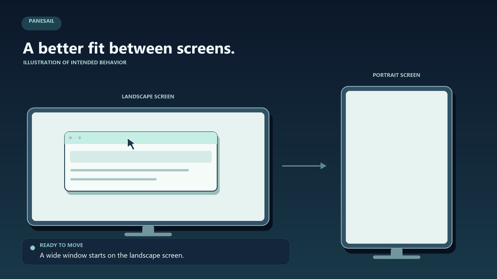

# PaneSail

PaneSail helps windows fit when you drag them between monitors. When an eligible window is too large for the destination's usable area, PaneSail can request an adjustment after you release the drag; a window that already fits stays where you dropped it. [How resizing is decided](src/WindowPalette.Windows/WindowResizeOperation.cs)

PaneSail is free, open-source software that works with Windows Command Palette. It is an independent project and is not a Microsoft product. [License](LICENSE) · [Third-party notices](THIRD-PARTY-NOTICES.md)

*Illustration of intended behavior; not a screen recording.*

## How it works

1. In Command Palette, open **PaneSail** and enable automatic resizing. It starts off until you enable it.
2. Drag a normal, resizable window by its title bar to another monitor, then release it.
3. For an eligible completed drag, if the window is too large, PaneSail requests one size-and-position adjustment. The application may constrain or decline that request. If the window's width and height already fit the destination's usable area, PaneSail makes no adjustment—even if you dropped part of the window outside that area. [Drag handling](src/WindowPalette.Windows/WindowEventMonitor.cs), [fit rule](src/WindowPalette.Windows/WindowResizeOperation.cs)

In settings you can choose **Match screen proportions**, which scales width and height independently to the destination, or **Keep window shape**, which only shrinks enough to fit without enlarging on a larger screen. You can disable automatic resizing at any time, and choose whether to start it with Windows. [Size rules](src/WindowPalette.Core/Geometry.cs), [controls](src/WindowPalette.CmdPal/Pages/DemoPage.cs)

## Requirements and limits

- The initial release targets Windows 11 on x64 with PowerToys and Command Palette enabled. [Extension discovery](https://learn.microsoft.com/en-us/windows/powertoys/command-palette/extensibility-overview)
- PaneSail supports recognized title-bar mouse drags of existing, normal, resizable windows. It skips Shift-drag and observed snapping gestures; compatibility with every application or window manager has not been established. [Gesture rules](src/WindowPalette.Core/GesturePolicy.cs), [window eligibility](src/WindowPalette.Windows/Native/WindowSnapshot.cs)
- Some apps use custom drag regions or minimum window sizes, and Windows or an app can make its own DPI adjustments. A window may therefore remain unchanged or fail to fit completely. Maximized-start drags, elevated windows, tab tear-outs, and keyboard moves are outside the initial support scope. [Window eligibility](src/WindowPalette.Windows/Native/WindowSnapshot.cs), [Windows DPI changes](https://learn.microsoft.com/en-us/windows/win32/hidpi/wm-dpichanged)

## Installation and support

The Microsoft Store listing is being prepared. Once it is available, install PaneSail from the Store, make sure Command Palette is enabled, then open PaneSail and turn on automatic resizing. To stop observing drags, disable automatic resizing from PaneSail. To remove the app, uninstall PaneSail through Windows. [Feature controls](src/WindowPalette.CmdPal/Pages/DemoPage.cs), [Windows app removal](https://support.microsoft.com/windows/uninstall-or-remove-apps-and-programs-in-windows-4b55f974-2cc6-2d2b-d092-5905080eaf98)

Read the [draft privacy notice](PRIVACY.md) to understand what the background feature accesses and stores. A private privacy contact will be added before distribution. For public support, use the project's issue tracker. See the [validation summary](VALIDATION.md) for what has and has not been verified.
